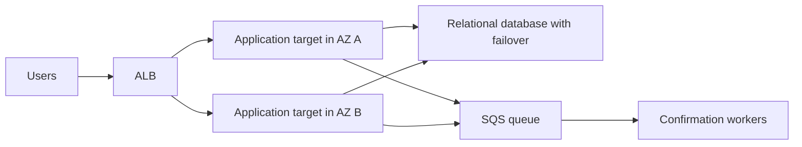

# Scaling a ticket booking service

A booking site starts on one EC2 instance. It then needs to survive one Availability Zone outage and handle bursts while avoiding duplicate confirmations.

Put the targets in an Auto Scaling group and keep sessions in an external store or use a suitable stateless design. Use a database transaction and a unique booking key to protect booking state. If the database write and event publication need to succeed together, consider a transactional outbox. Consumers must handle retries without producing duplicate confirmations.

Test loss of one zone, database failover and queue backlog independently. Measure time to recover and check that the surviving application capacity can meet the target request rate. A separate regional recovery design is needed if the service must survive loss of a Region.

[Resilient architectures](../02-resilient-architectures/README.md)
