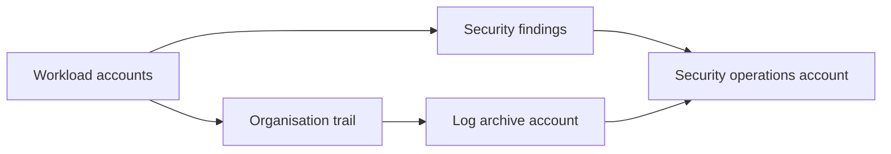

# Multi-account security telemetry

Use a log archive account for long-term evidence and a security operations account for analysis. Workload accounts produce telemetry. An organisation trail can deliver account activity centrally, and supported services can use delegated administration for findings. Keep evidence access distinct from permissions to administer workloads.

Test account enrolment, log delivery and read access with a benign event. Compare the source event timestamp to its arrival in each destination. Check alert routing separately. Plan access for authorised incident responders and document who can change retention or encryption settings.

[Detection](../01-detection/README.md) · [Incident response](../02-incident-response/README.md)
